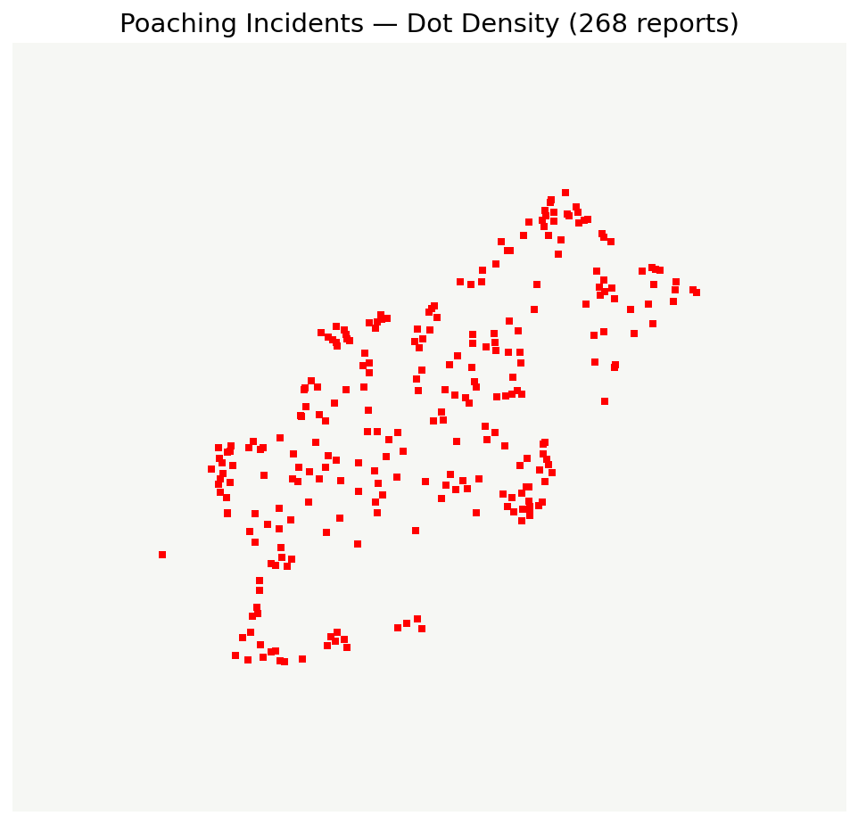
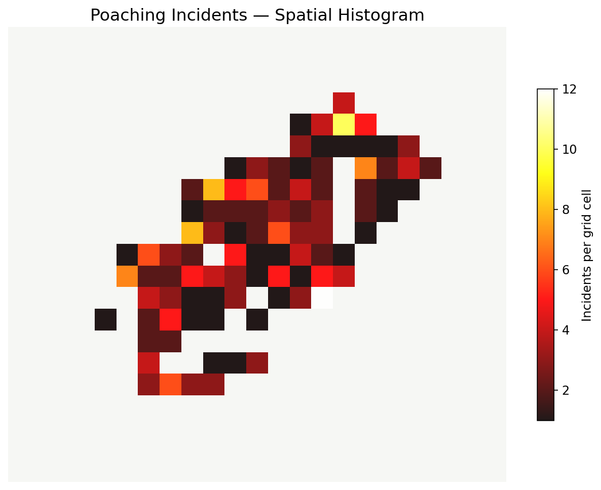
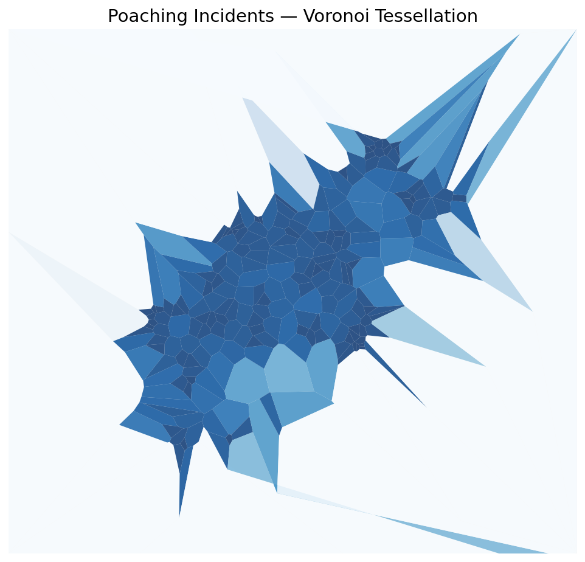

# Mapping Poaching Incident Locations in Tanzania

## Research question
How can dot-density, spatial histogram and Voronoi visualizations reveal geographic patterns in the recorded poaching incidents in Tanzania?

## Dataset
- **File:** `poaching_points_cleaned.csv`
- **Description:** The dataset contains 268 recorded poaching incidents in Tanzania, with six fields: `id_report`, `date_report`, `description`, `created_date`, `lat`, and `lon`.
- **Course source:** Dataset supplied as part of the CISC7204 Tutorial 08-01 learning materials.
- **Related educational reference:** *The Data Visualization Workshop*, Packt Publishing, Chapter 5, "Plotting Geospatial Data."
- **Reference repository:** https://github.com/TrainingByPackt/Data-Visualization-with-Python
- **Usage and redistribution permissions:** The dataset was provided for educational analysis. Its original licensing and public redistribution permissions have not been independently verified.

The raw CSV is not redistributed in this public repository. Users should obtain the dataset from an authorized source and place it in the directory specified in the notebook instructions.

**The raw CSV is not included in this public repository until its redistribution permission is confirmed.** Obtain it from its authorized source and place it next to the notebook, or in a sibling `Datasets/` folder.

## Methods and tools
Python, pandas, NumPy and Geoplotlib. The notebook imports the records and visualizes them as points, a spatial histogram (`binsize=20`) and Voronoi tessellation (`cmap='Blues_r'`).

## Results and visualizations
The incident locations are spatially uneven, with some groups of points closer together than others. A spatial histogram makes concentrations easier to spot than a raw table.

**Note:** The PNG images below were separately rendered from the uploaded dataset for presentation. They are **not** screenshots of the Geoplotlib notebook running. The notebook contains the Geoplotlib code for reproducing its own maps.

### Dot density

### Spatial histogram

### Voronoi

## Limitations
Incident records may not represent all events, and point concentration is not a causal explanation of poaching risk. In addition, Geoplotlib 0.3.2 is an older package: the default Carto map tiles may return `API KEY REQUIRED` or HTTP errors, so exact background maps may not reproduce today.

## Running the analysis
1. Install Python 3.11 and create a dedicated virtual environment.
2. Install the compatible dependencies from `requirements.txt`. Geoplotlib 0.3.2 may require older setuptools (e.g., 57.5.0) and installation with `--no-build-isolation` because its source distribution uses the retired `use_2to3` build option.
3. Put `poaching_points_cleaned.csv` beside `poaching_geospatial_analysis.ipynb` (or in a sibling `Datasets/` folder).
4. Launch Jupyter with the environment selected and run the notebook cells in order.
5. Geoplotlib usually shows maps in separate graphical windows; modern tile services may not work with its legacy client.

## Project status
Course project complete; README and publication/licensing review in progress.
